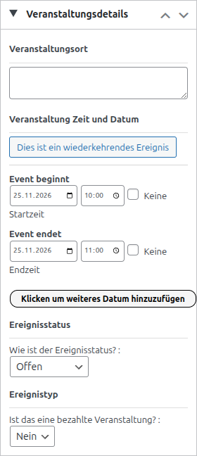

# PS Events

PS Events erweitert WordPress und ClassicPress um Veranstaltungsverwaltung und
RSVP-Buchungen. Veranstaltungen haben eigene Detailseiten und ein Archiv; auf
Wunsch lassen sich wiederkehrende Termine, Ticketpreise und optionale
Erweiterungen nutzen.

*Der Screenshot zeigt den Veranstaltungseditor in der lokalen MarketPress-Demo.*

## Funktionen auf einen Blick

- Veranstaltungen mit Beschreibung, Ort, Datum, mehreren Terminen und
  optionaler Wiederholung anlegen.
- RSVP-Antworten verwalten und Teilnehmende exportieren.
- Archive, Kalender, Einzelveranstaltungen und vergangene Termine per
  Shortcode ausgeben.
- Optional: Kapazitätsgrenzen, manuelle oder integrierte Zahlungen, E-Mail-
  Benachrichtigungen, Kalenderexport, Karten und Multisite-Ansichten.

Erweiterungen werden in den Plugin-Einstellungen einzeln aktiviert. Einige
Funktionen setzen ein zusätzliches PSOURCE-Plugin, einen API-Zugang oder eine
Multisite-Installation voraus.

## Schnellstart

1. PS Events im gewünschten WordPress-/ClassicPress-Netzwerk oder auf der
   einzelnen Website aktivieren.
2. Unter **Einstellungen → Permalinks** eine Permalink-Struktur auswählen, die
   nicht „Einfach“ ist.
3. Unter **Veranstaltungen → Einstellungen** den Archiv-Slug und gewünschte
   Optionen prüfen.
4. Unter **Veranstaltungen → Neues Ereignis hinzufügen** einen Termin anlegen
   und veröffentlichen.
5. Das Archiv unter `/<slug>/` öffnen (standardmäßig `/events/`).

Die ausführliche Anleitung zu Bedienung, RSVP, Shortcodes, Erweiterungen und
Multisite steht im [Handbuch](handbuch/README.md).

## Datums- und Zeiteingabe

Der Veranstaltungseditor nutzt native Datums- und Uhrzeitfelder des Browsers.
PS Events benötigt dafür weder jQuery UI noch einen externen Dienst.
