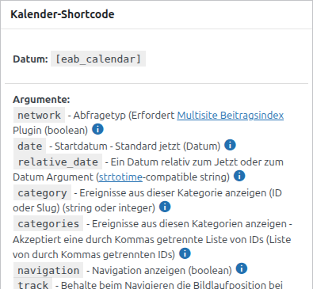

# PS Events

<p align="center">
  
</p>

**Vom ersten Termin bis zur Gästeliste – direkt in WordPress und ClassicPress.**

Plane einen Vereinsabend, organisiere einen Workshop mit begrenzten Plätzen
oder veröffentliche das Programm deines gesamten Website-Netzwerks. PS Events
verbindet Veranstaltungsseiten, Kalender und Anmeldungen. Du kannst kostenlos
starten und Funktionen wie Zahlungen, Erinnerungen oder einen Wochenkalender
bei Bedarf ergänzen.

[Funktionen](#was-du-mit-ps-events-machen-kannst) ·
[Kalender & Shortcodes](#dein-programm-auf-deiner-website) ·
[Multisite](#ein-netzwerk-ein-gemeinsamer-kalender) ·
[Schnellstart](#schnellstart) ·
[Handbuch](./handbuch/README.md)

## Was du mit PS Events machen kannst

| Dein Vorhaben | So hilft PS Events |
| --- | --- |
| **Ein Meetup oder Vereinsfest ankündigen** | Veröffentliche eine eigene Veranstaltungsseite mit Beschreibung, Ort und Termin. Gäste können zusagen, absagen oder „vielleicht“ wählen. |
| **Ein Festival oder eine Kursreihe planen** | Lege mehrere Zeitblöcke in einer Veranstaltung an oder definiere eine Serie, etwa jeden Montag und Mittwoch bis zum Kursende. |
| **Einen Workshop mit begrenzten Plätzen organisieren** | Ergänze ein Platzlimit, einen Anmeldeschluss und eigene Fragen, etwa zur Ausstattung oder zum Kenntnisstand. Exportiere die Gästeliste als CSV. |
| **Eine kostenpflichtige Veranstaltung anbieten** | Hinterlege einen Preis. Je nach Konfiguration stehen PayPal, manuelle Zahlungen oder eine PS-eCommerce-Anbindung zur Verfügung. |
| **Die Termine mehrerer Standorte bündeln** | Jede Website pflegt ihre eigenen Veranstaltungen. Mit dem Multisite Beitragsindex kannst du sie in einem gemeinsamen Kalender anzeigen. |

### Termine planen, ohne sie einzeln zu kopieren

Für ein Wochenende mit Vormittags- und Abendprogramm trägst du mehrere
Zeitabschnitte im selben Ereignis ein. Für einen regelmäßigen Kurs legst du
stattdessen einen Zeitraum und eine Wiederholungsregel fest. Bei einer
Wochenserie lassen sich mehrere Wochentage, die Startzeit und die Dauer
angeben. Auch Termine ohne konkrete Start- oder Enduhrzeit sind möglich.

<p align="center">
  
  &nbsp;
  
</p>

*Screenshots aus der MarketPress-Demo: Einzeltermin und Wochenserie.
Der Editor verwendet native Datums- und Uhrzeitfelder ohne jQuery UI.*

### Anmeldungen, Gästeliste und Zahlungen

Im Backend siehst du die Rückmeldungen nach Antwortstatus und kannst die
Teilnehmenden als CSV exportieren. Für eine kostenlose Veranstaltung brauchst
du keinen Zahlungsanbieter.

Unter **Veranstaltungen → Einstellungen → Erweiterungen** kannst du den
Ablauf anpassen:

- **Anmeldung:** Teilnehmerzahl begrenzen, Anmeldungen vor dem Termin
  schließen oder zusätzliche Angaben abfragen. Mit der passenden Erweiterung
  ist auch eine RSVP per E-Mail-Adresse statt mit Website-Konto möglich.
- **Kommunikation:** Bestätigungen verschicken, Veranstaltende über neue
  Anmeldungen informieren und Gäste bei Änderungen oder einer Absage benachrichtigen.
- **Preise und Zahlung:** Mehrere Preise anbieten oder eine Überweisung
  hinterlegen. Bei manueller Zahlung kann PS Events unter passenden
  Voraussetzungen einen EPC-QR-Code anzeigen, etwa bei einem positiven
  EUR-Betrag und gültiger IBAN.
- **Ohne Anmeldung:** Mit der Erweiterung für öffentliche Ankündigungen
  kannst du Veranstaltungen auch ohne RSVP veröffentlichen.

## Dein Programm auf deiner Website

Jede veröffentlichte Veranstaltung hat eine eigene Seite. Das Archiv liegt
standardmäßig unter `/events/`. Mit Shortcodes kannst du das Programm auch
in bestehende Seiten einbauen, ohne eine Vorlage zu schreiben:

| Was auf die Seite soll | Beispiel |
| --- | --- |
| Ein Kalender mit Navigation | `[eab_calendar navigation="1"]` |
| Eine Liste mit bis zu zehn Workshops | `[eab_archive category="workshop" limit="10"]` |
| Eine bestimmte Veranstaltung, etwa auf einer Kursseite | `[eab_single id="123"]` |
| Vergangene Veranstaltungen, etwa für einen Rückblick | `[eab_expired]` |



*Unter **Veranstaltungen → Shortcodes** findest du die verfügbaren Argumente
und siehst, welche Filter sich für deine Programmseite eignen.*

Für andere Ansichten gibt es optionale Erweiterungen: einen Wochenkalender
mit einstellbarem Zeitraster, einen Countdown, eine Kalenderansicht für eine
einzelne Terminserie oder Karten mit **PS Google Maps**. Per iCalendar-Export
oder Google-Kalender-Schaltfläche können Gäste Termine in ihren eigenen
Kalender übernehmen.

### Veranstaltungen gemeinsam pflegen

Mit **PS Community** lassen sich Veranstaltungen mit Gruppen verbinden und in
Benutzerprofilen anzeigen. Für Teams, die nicht im Dashboard arbeiten sollen,
kannst du den Frontend-Editor als Erweiterung aktivieren und mit
`[eab_event_editor]` in eine Seite einbetten. Wer Veranstaltungen bearbeiten
darf, hängt von den Berechtigungen ab.

## Ein Netzwerk, ein gemeinsamer Kalender

In einer Multisite-Installation kannst du PS Events auf einzelnen Websites
oder zentral aktivieren. **Veranstaltungen und Buchungen bleiben pro Website
gespeichert.** So verwaltet etwa jeder Standort sein eigenes Kursprogramm,
während eine zentrale Seite die Termine mehrerer Standorte zusammenführt.

Die gemeinsame Ansicht benötigt das Plugin **Multisite Beitragsindex**
(Post Indexer). Erst damit stehen die Netzwerkabfrage und das Netzwerk-Widget
zur Verfügung; die Netzwerkaktivierung allein genügt nicht.

```text
[eab_calendar network="1"]
```

Zur [Einrichtung der Netzwerkfunktionen im Handbuch](./handbuch/README.md#multisite-und-netzwerkfunktionen).

## Schnellstart

1. **PS Events aktivieren** und unter **Einstellungen → Permalinks** eine
   Struktur wählen, die nicht „Einfach“ ist.
2. Unter **Veranstaltungen → Ereignis hinzufügen** einen kostenlosen
   Testtermin mit Ort, Start und Ende anlegen und veröffentlichen.
3. Die Veranstaltungsseite oder das Archiv unter `/events/` öffnen und die
   Anmeldung ausprobieren. Wenn du den Archiv-Slug geändert hast, nutze den
   gewählten Pfad.
4. Im Editor unter **Ereignis RSVPs** kontrollieren, ob die Rückmeldung
   angekommen ist.

Das [Handbuch](./handbuch/README.md) führt dich durch die Einrichtung,
Anmeldungen, Shortcodes, Zahlungen und Multisite. Einige Erweiterungen
benötigen weitere PSOURCE-Plugins, Zugangsdaten oder externe Dienste.
