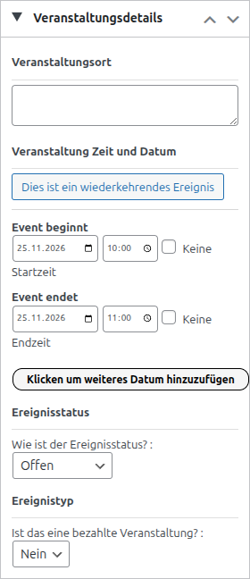
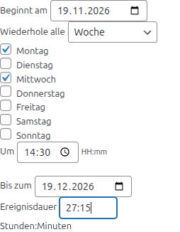
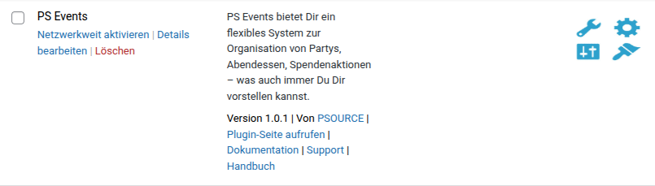

# PS Events – Handbuch

Dieses Handbuch beschreibt die Bedienung und die wichtigsten Funktionen von
PS Events. Die genauen Menünamen können je nach WordPress-/ClassicPress-Version,
Sprache und aktivierten Erweiterungen variieren.

## Inhaltsverzeichnis

- [Überblick](#überblick)
- [Installation und Grundeinrichtung](#installation-und-grundeinrichtung)
- [Veranstaltungen erstellen](#veranstaltungen-erstellen)
- [RSVPs und Teilnehmende verwalten](#rsvps-und-teilnehmende-verwalten)
- [Darstellung auf der Website](#darstellung-auf-der-website)
- [Zahlungen](#zahlungen)
- [Erweiterungen](#erweiterungen)
- [Multisite und Netzwerkfunktionen](#multisite-und-netzwerkfunktionen)
- [Fehlerbehebung](#fehlerbehebung)

## Überblick

PS Events fügt den eigenen Inhaltstyp **Veranstaltungen** hinzu. Jede
Veranstaltung kann eine Beschreibung, einen Veranstaltungsort, einen oder
mehrere Termine, einen Status und RSVP-Antworten haben. Das Plugin stellt
außerdem ein Veranstaltungsarchiv, Einzelansichten, Shortcodes, Widgets und
optionale Erweiterungen bereit.

Im Adminbereich befinden sich die wichtigsten Funktionen unter
**Veranstaltungen**:

- **Eventboard**: Einstieg und Links zu den ersten Schritten.
- **Alle Veranstaltungen**: Veranstaltungen suchen und bearbeiten; die Liste
  enthält Datum, Ort und RSVP-Zusammenfassung.
- **Neue Veranstaltung hinzufügen**: Editor und Veranstaltungsdetails öffnen.
- **Ereigniskategorien**: Veranstaltungen thematisch ordnen.
- **Einstellungen**: Archiv, Darstellung, Buchungen und optionale Funktionen
  konfigurieren.
- **Shortcodes**: Übersicht der verfügbaren Shortcodes und ihrer Argumente.

## Installation und Grundeinrichtung

1. PS Events installieren und aktivieren. In einer Multisite kann es auf
   einzelnen Websites oder – sofern gewünscht – netzwerkweit aktiviert werden.
2. **Einstellungen → Permalinks** öffnen und eine Permalink-Struktur auswählen,
   die nicht **Einfach** ist. Danach die Änderungen speichern. PS Events
   benötigt Rewrite-Regeln für das Veranstaltungsarchiv und die Einzelseiten.
3. **Veranstaltungen → Einstellungen** öffnen und den Root-Slug prüfen. Der
   Standard lautet `events`; unter diesem Pfad erscheint das Archiv.
4. Bei Bedarf Sortierrichtung, Archiv-Paginierung und Darstellungsvorlagen
   anpassen. Theme-Vorlagen können die Plugin-Standardvorlagen ersetzen.
5. Zahlungs- und Anmeldeoptionen nur aktivieren, wenn sie für die Website
   eingerichtet und getestet wurden.

Für eine normale, kostenlose RSVP-Veranstaltung ist kein Zahlungsanbieter
erforderlich. Die lokale MarketPress-Demo wurde ohne echte Zahlungsdaten
eingerichtet.

## Veranstaltungen erstellen

1. **Veranstaltungen → Neues Ereignis hinzufügen** öffnen.
2. Titel und Beschreibung wie bei einem normalen Beitrag eintragen.
3. Im Feld **Veranstaltungsort** eine Ortsangabe ergänzen. Für Karten ist eine
   kompatible Karten-Erweiterung erforderlich.
4. Unter **Veranstaltung Zeit und Datum** Start und Ende über die Datums- und
   Uhrzeitfelder des Browsers festlegen. Mit
   **Dies ist ein wiederkehrendes Ereignis** lassen sich Wiederholungen
   einrichten; die Dauer wird als Stunden und Minuten eingegeben (z. B. `01:30`).
   Über **Klicken um weiteres Datum hinzuzufügen** kannst du weitere einzelne
   Zeitabschnitte anlegen.
5. Den Ereignisstatus wählen. Für eine buchbare Veranstaltung muss sie offen
   sein; geschlossene oder abgelaufene Veranstaltungen nehmen keine normalen
   RSVPs entgegen.
6. Bei Bedarf eine Kategorie auswählen. Für kostenpflichtige Veranstaltungen
   zusätzlich den bezahlten Veranstaltungstyp und den Preis konfigurieren.
7. Mit **Veröffentlichen** speichern. Die Veranstaltung erscheint im Archiv
   und erhält eine eigene Detailseite.

Im Screenshot ist der Editor mit Veranstaltungsdetails zu sehen:



### Wiederkehrende Termine

Die Wiederholung wird am Hauptereignis konfiguriert. PS Events erzeugt dazu
zugehörige Termine für den gewählten Zeitraum. Beim Veröffentlichen werden die
Instanzen angelegt; beim Löschen oder Verschieben des Hauptereignisses in den
Papierkorb werden sie mitverwaltet. Prüfe nach dem Speichern die im Archiv
angezeigten Termine.



## RSVPs und Teilnehmende verwalten

Besucher können – abhängig von der Website-Konfiguration – ihre Teilnahme
bestätigen, absagen oder „vielleicht“ auswählen. Die Buchung wird in der
Veranstaltung gespeichert.

Im Bearbeitungsbildschirm der Veranstaltung zeigt **Ereignis RSVPs** die
Teilnehmenden nach Antwortstatus. In der Veranstaltungsübersicht gibt es eine
Zusammenfassung und einen Export der Teilnehmenden. Für eine RSVP-Abgabe ist
standardmäßig ein WordPress-/ClassicPress-Benutzerkonto erforderlich.
Optionale Social-Login- oder E-Mail-RSVP-Funktionen brauchen zusätzliche
Konfiguration und sind nicht automatisch aktiv.

## Darstellung auf der Website

PS Events erzeugt automatisch ein Archiv und Einzelseiten. Der Standard-Slug
ist `events`; bei einem anderen Slug ändert sich entsprechend die URL. Themes
bestimmen einen Teil der Darstellung. Vorlagen können in den Einstellungen
ausgewählt oder durch passende Theme-Dateien überschrieben werden.

Das öffentliche Archiv der Demo-Seite ist unter `/marketpress-demo/events/`
erreichbar. Es bleibt leer, solange keine Veranstaltung veröffentlicht wurde.

### Shortcodes

Shortcodes lassen sich in Seiten und Beiträgen einsetzen:

| Shortcode | Zweck |
| --- | --- |
| `[eab_calendar]` | Kalenderansicht der bevorstehenden Veranstaltungen |
| `[eab_archive]` | Liste bzw. Archivansicht mit Filter- und Datumsoptionen |
| `[eab_single id="123"]` | Eine Veranstaltung anhand ihrer ID anzeigen |
| `[eab_single slug="veranstaltung"]` | Eine Veranstaltung anhand ihres Slugs anzeigen |
| `[eab_expired]` | Vergangene Veranstaltungen anzeigen |
| `[eab_events_map]` | Veranstaltungskarten anzeigen; benötigt PS Google Maps |
| `[eab_my_events]` | Persönliche Veranstaltungen; benötigt die passende Community-Erweiterung |

Beispiele:

```text
[eab_calendar navigation="1"]
[eab_archive limit="10" category="workshop"]
[eab_single id="123"]
```

Die Seite **Veranstaltungen → Shortcodes** listet die verfügbaren Argumente
auf. Welche Argumente unterstützt werden, hängt vom jeweiligen Shortcode ab.
Ein kommaseparierter Kategorienfilter kann beispielsweise über `categories`
angegeben werden.

Ein Kalender-Widget für bevorstehende Veranstaltungen ist ebenfalls enthalten.
Ein Netzwerk-Widget wird nur angeboten, wenn die Multisite-Voraussetzungen aus
dem nächsten Abschnitt erfüllt sind.

## Zahlungen

Zahlungen sind optional. Für PayPal müssen Zahlungsannahme, Währung und
PayPal-Adresse korrekt eingerichtet sein; zum Testen steht ein Sandbox-Modus
zur Verfügung. Erst nach einem erfolgreichen Test sollte eine produktive
Zahlungsadresse verwendet werden.

Die optionale Erweiterung **Manuelle Zahlungen** erlaubt Hinweise zu
Überweisung oder Scheck. Je nach Konfiguration können Kontoinhaber, IBAN,
optionale Bankdaten und ein Referenzpräfix hinterlegt werden. Ein EPC-QR-Code
wird nur angezeigt, wenn die Voraussetzungen – unter anderem eine gültige
IBAN, EUR und ein positiver Preis – erfüllt sind. Solche Zahlungsdaten gehören
nicht in eine öffentliche Demo- oder Entwicklungsumgebung.

## Erweiterungen

Unter **Veranstaltungen → Einstellungen → Erweiterungen** können verfügbare
Add-ons einzeln aktiviert und deaktiviert werden. Nicht jede Erweiterung ist
für jede Installation geeignet; manche benötigen zusätzliche Plugins,
Zugangsdaten oder externe Dienste.

Beispiele nach Themen:

- **RSVP und Organisation**: Teilnehmerkapazität, zusätzliche
  Registrierungsfelder, RSVP-Schlusszeit, Erinnerungen, Absagen und
  Bestätigungs-E-Mails.
- **Termine und Darstellung**: wiederkehrende Kalender, Wochenkalender,
  Countdown zum nächsten Ereignis und Anzeige persönlicher Veranstaltungen.
- **Zahlung und Export**: manuelle Zahlungen, mehrere Preise,
  PSeCommerce-Integration, iCal- und Google-Kalender-Export.
- **Import und Integrationen**: Importe aus Google Kalender, Meetup oder
  Facebook sowie Community- und Kartenfunktionen. Verfügbarkeit und
  Zugangsdaten des jeweiligen Drittanbieters müssen separat geprüft werden.

## Multisite und Netzwerkfunktionen

PS Events kann in WordPress-Multisite verwendet werden. Veranstaltungen und
Buchungen werden pro Website gespeichert. Eine Netzwerkaktivierung bedeutet
daher nicht automatisch, dass eine gemeinsame netzwerkweite Veranstaltungsliste
angezeigt wird.

Für eine zentrale Aktivierung findest du PS Events unter **Meine Websites →
Netzwerkverwaltung → Plugins**. Soll PS Events nur auf einer einzelnen
Website laufen, aktiviere es stattdessen in deren eigener Plugin-Liste.



*In der lokalen Demo blieb PS Events nur auf MarketPress Demo aktiv. Die
netzwerkweite Ausgabe wurde nicht praktisch geprüft.*

Für die netzwerkweite Sammlung benötigt PS Events das **Multisite
Beitragsindex**-Plugin (Post Indexer), das Beiträge aus den Websites im
Netzwerk indexiert. Wenn Multisite und Indexer aktiv sind, kann die
Kalenderansicht mit dem Argument `network` netzwerkweit abgefragt werden:

```text
[eab_calendar network="1"]
```

Das Netzwerk-Widget für bevorstehende Veranstaltungen wird ebenfalls nur
registriert, wenn diese Voraussetzungen erfüllt sind. Ohne Post Indexer bleiben
Kalender und Widgets auf Veranstaltungen der aktuellen Website beschränkt.
Prüfe bei einer Netzwerkinstallation außerdem die Aktivierung und
Berechtigungen auf jeder gewünschten Website.

## Fehlerbehebung

- **Archiv oder Einzelseiten zeigen einen 404-Fehler:** Unter
  **Einstellungen → Permalinks** eine nicht-einfache Struktur speichern.
- **Veranstaltungen erscheinen nicht im Netzwerk-Kalender:** Prüfen, ob die
  Installation Multisite verwendet und der Multisite Beitragsindex aktiv und
  aktuell ist. `network="1"` wird nur dort ausgewertet.
- **Karten oder Social Login fehlen:** Die jeweilige Erweiterung und das
  passende PSOURCE-Plugin bzw. die API-Konfiguration prüfen.

Vor einem produktiven Einsatz empfiehlt sich ein Test mit einer kostenlosen
Veranstaltung: veröffentlichen, Archiv und Detailseite prüfen, RSVP abgeben,
Teilnehmerliste kontrollieren und – falls aktiviert – den Export und den
Zahlungsablauf in einer Sandbox testen.
